# [Wireless Sensors] Improve Wireless Sensor Network Routing and Data Packet Transmission with Mamdani Fuzzy Inference System (Matlab Code Implementation)

🏆 Bloggers' Advantage: 🌞🌞🌞 The content of the blog strives to be rigorous in thought and clear in logic, for the convenience of readers.
⛳️ Mantra: The journey of a hundred miles is half done in the last ninety.
📋📋📋This article is organized as follows: 🎁🎁🎁Table of Contents💥1 Overview📚2 Running Results🎉3 References🌈4 MATLAB Code Implementation
💥1 Overview of using the Mamdani Fuzzy Inference System (FIS) to improve wireless sensor network routing and packet transmission. The FIS decides on the best route among all found routes based on message importance and network conditions (traffic, etc.).
📚2 Running Results Editing
Editor
Editor
Editor
Editor
Editor
Editor
Editor
Editor
Editor
Editor
Part of the code:
%% Making Network:  
global position N  
N=50; % Number of Nodes in network  
position=randsrc(2,N,1:1000); % set position of each node in network 1000x1000 meters  
S=1; % Source Node  
D=50; % Destination Node  
Net=zeros(N);  
range=250; % Radio propagation range of each node (meter)  
plot(position(1,:),position(2,:),'ro');  
title('Network');  
xlabel('x (m)');  
ylabel('y (m)');  
grid();  
hold on  
for i=1:N  
for j=1:N  
if i~=j && dist(position(:,i)',position(:,j))<=range  
Net(i,j)=1; %Connection between 2 nodes (i,j)  
line([position(1,i),position(1,j)],[position(2,i),position(2,j)]);  
end  
end  
end  
plot(position(1,S),position(2,S),'ks');  
plot(position(1,D),position(2,D),'g^');  
%% Route Discovery:  
for i=1:30  
path=S;  
tik=zeros(1,N);  
tik(S)=1;  
while (1)  
a=find(Net(path(end),:)==1);  
b=a(tik(a)==0);  
if isempty(b)==1  
break;  
end  
next=randsrc(1,1,b);  
if tik(next)==0  
path=[path,next];  
tik(next)=1;  
end  
if path(end)==D  
routePool{i}=path;  
break;  
end  
end  
end  
j=1;  
for i=1:numel(routePool)  
if isempty(routePool{i})==0  
Pool{j}=routePool{i};  
j=j+1;  
end  
end  
for i=1:numel(Pool)-1  
for k=i+1:numel(Pool)  
if numel(Pool{i})== numel(Pool{k})  
if sum(Pool{i}==Pool{k})==numel(Pool{k})  
Pool{k}=[];  
end  
end  
end  
end  
routePool=Pool;  
clear Pool;  
j=1;  
for i=1:numel(routePool)  
if isempty(routePool{i})==0  
Pool{j}=routePool{i};  
j=j+1;  
end  
end  
for k=1:numel(Pool)  
figure, plot(position(1,:),position(2,:),'ro');  
hold on;  
for i=1:numel(Pool{k})-1  
line([position(1,Pool{k}(i)),position(1,Pool{k}(i+1))],[position(2,Pool{k}(i)),position(2,Pool{k}(i+1))]);  
end  
end  
%% Sorting routes  
for i=1:numel(Pool)  
count(i)=numel(Pool{i});  
end  
[~,idx]=sort(count);  
for i=1:numel(Pool)  
sPool{i}=Pool{idx(i)};  
end  
Pool=sPool;  
clear sPool  
%% Packet Injection  
packeti=rand(2500,1); % message importance  
packetc=50*ones(2500,1); % Capasity of message (from 1 kb to 100 kb)  
packet=[packeti,packetc];  
j=1;  
disp('----------------------------');  
discard=0;  
tl=zeros(1,50);  
E=tl;  
kk=1;  
🎉3 References
🌈4 Matlab code implementation

## Images

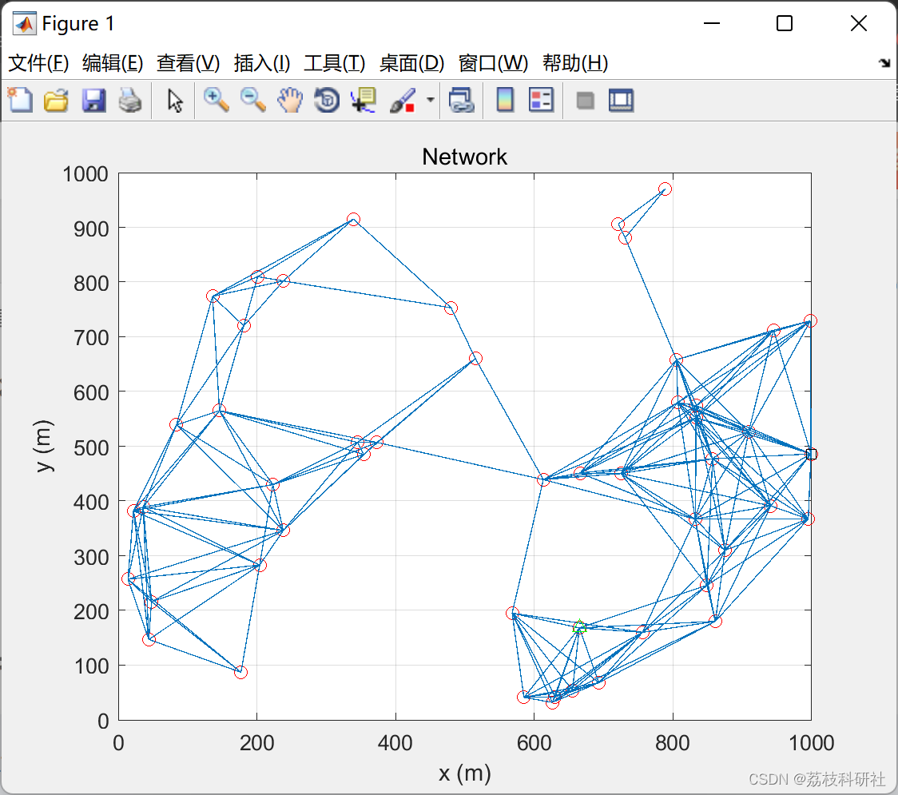
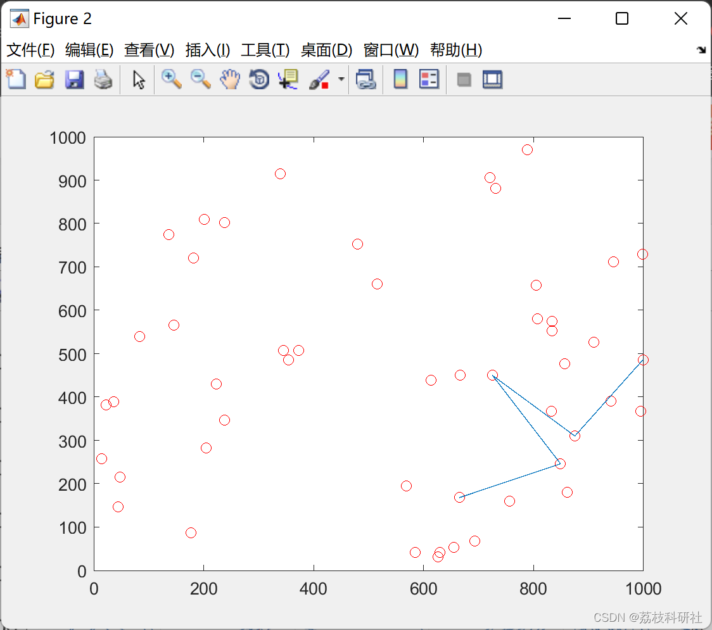
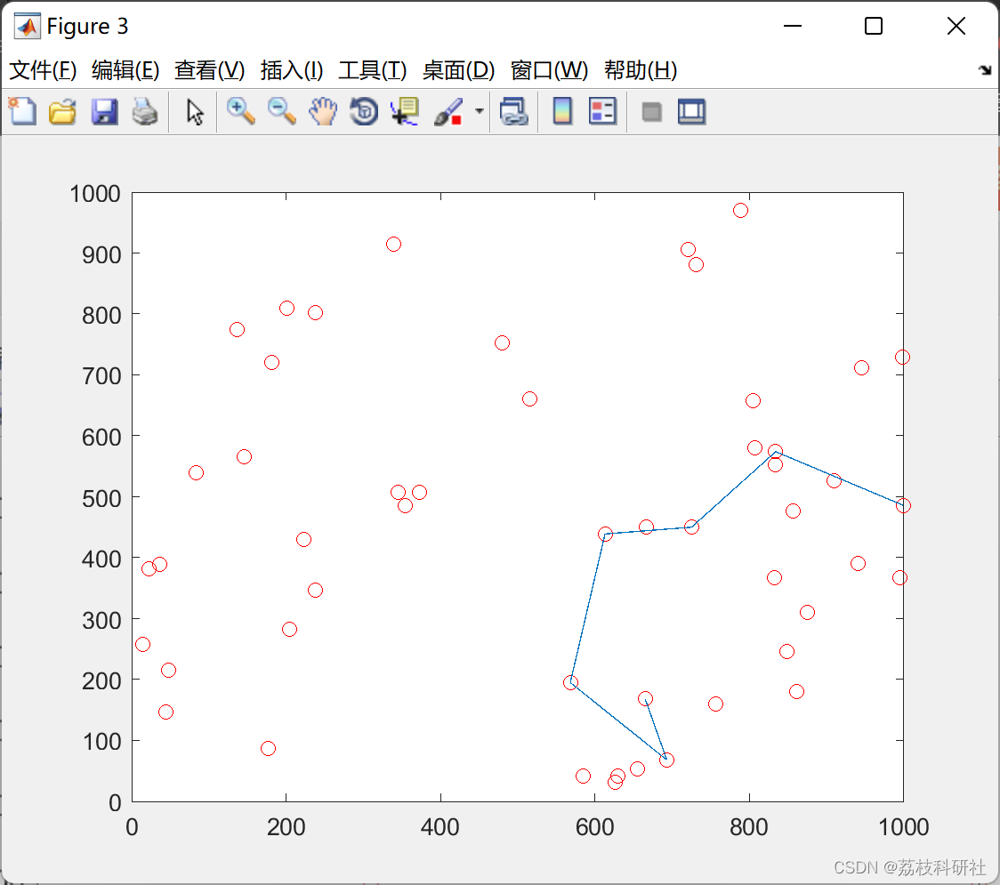
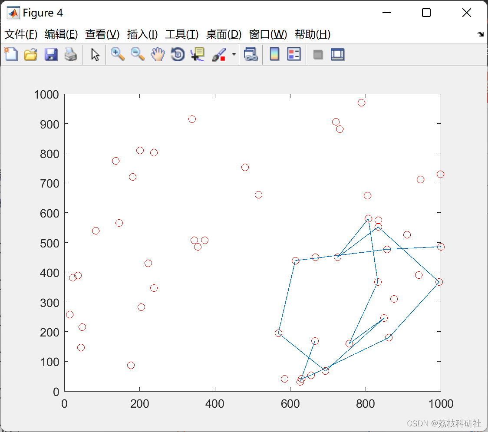
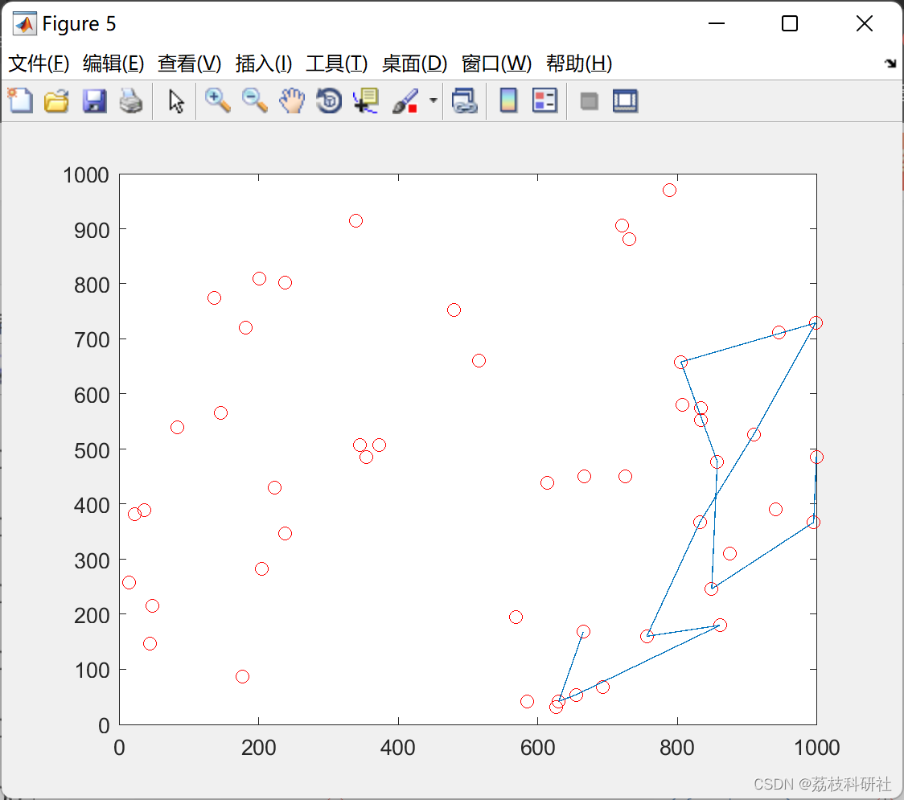
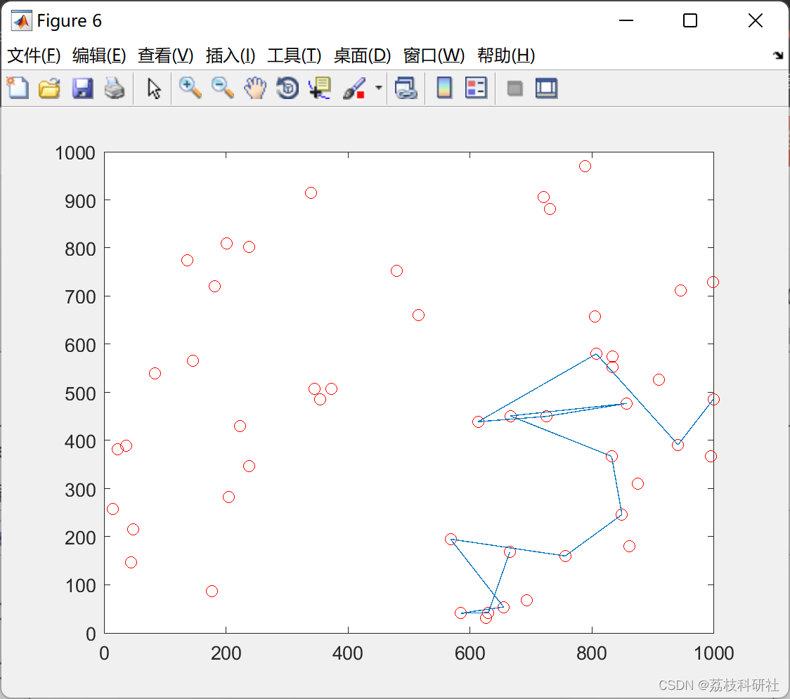
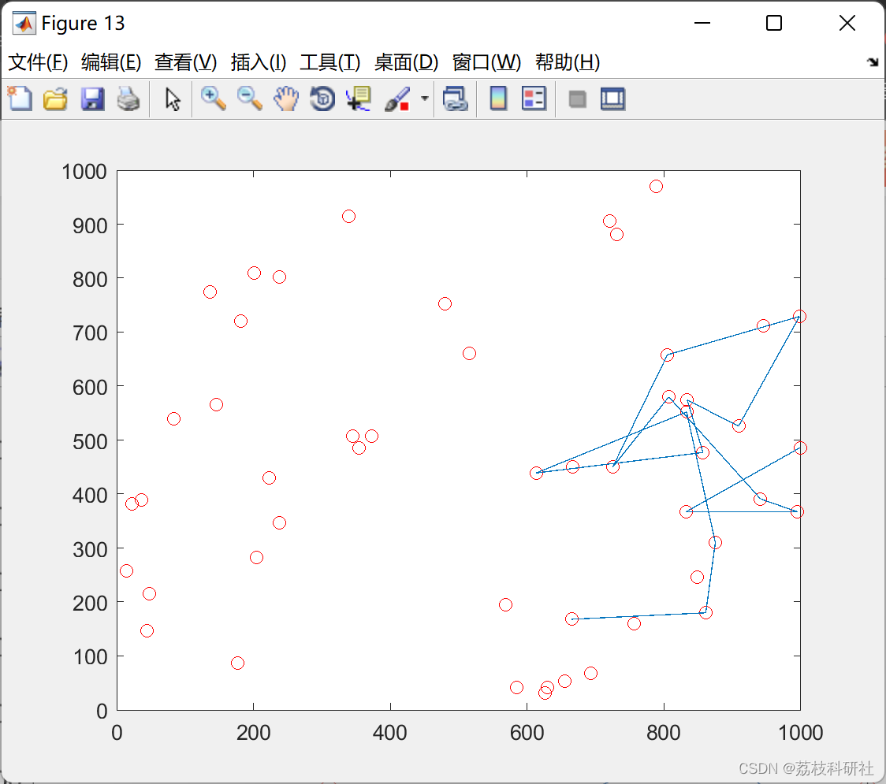
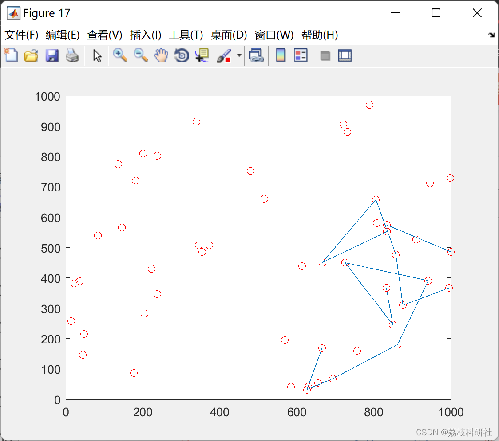
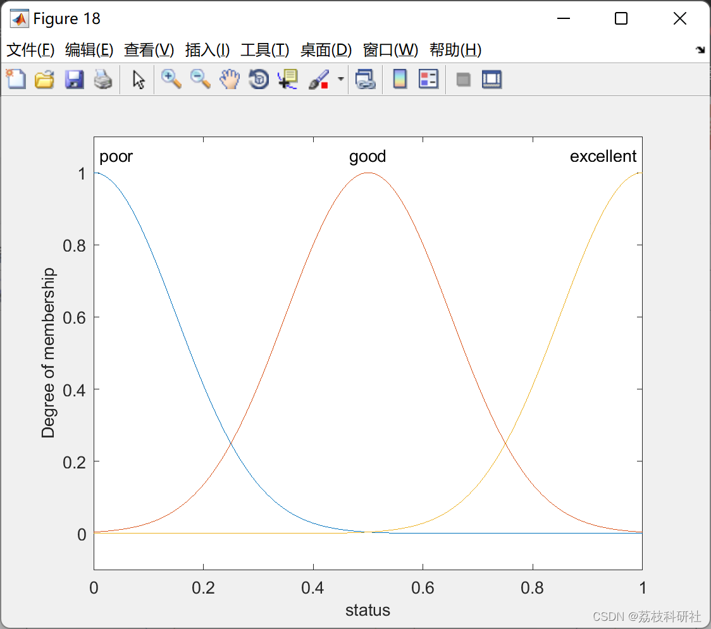
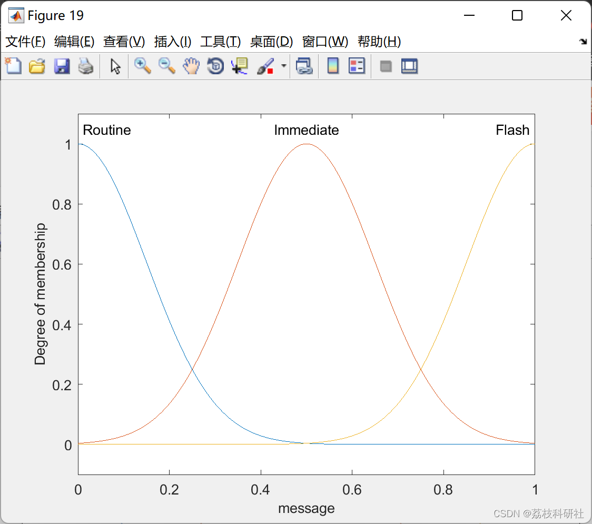
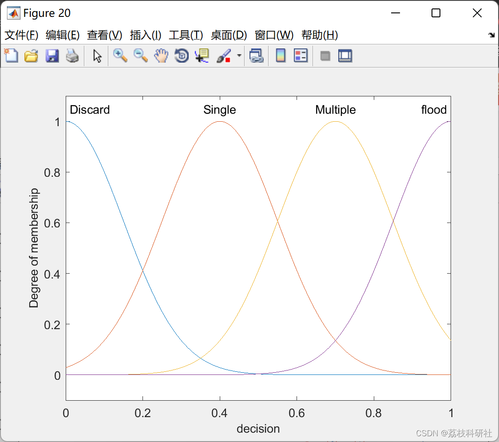

<!-- PAYMENT_BLOCK -->

## Get this dataset

- Payment link (Stripe): [Buy now](https://buy.stripe.com/3cs8yP7sY87d0vu9AB)
- Payment QR code: 

<!-- /PAYMENT_BLOCK -->
